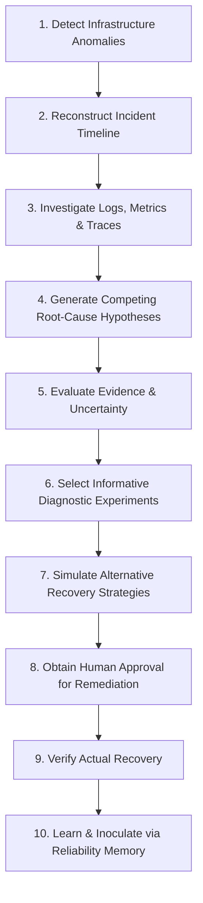

# 🚀 INCIDENTX AI — Product Vision & Strategic Manifesto

> **Project Name:** INCIDENTX AI  
> **Product Category:** Autonomous AI Incident Investigation and Self-Healing Platform  
> **Tagline:** The Autonomous Reliability Intelligence System  
> **Status:** Phase 0 Architectural Blueprint

---

## 1. Executive Summary

Modern cloud-native systems are distributed, heterogeneous, dynamic, and non-deterministic. As microservices, serverless workloads, distributed databases, service meshes, and container orchestrators scale to thousands of interconnected components, failure modes become emergent and non-linear.

During production incidents:
- **Alert Storms Blind Operators**: Cascading faults trigger hundreds of dependent alerts across observability tools, drowning the primary signal in downstream noise.
- **Cognitive Overload**: On-call engineers are forced to mentally assemble fragmented evidence across distributed trace waterfalls, metrics dashboards, application logs, and deployment histories.
- **Shallow "AIOps" Failures**: First-generation AI SRE tools operate either as statistical correlation heuristics (which repeatedly confuse symptoms with root causes) or as superficial LLM chat wrappers (which hallucinate plausible explanations, lack environmental grounding, and provide no execution safety).
- **The Execution Fear Barrier**: Teams refuse to automate remediation because conventional tools offer zero pre-execution safety verification, leaving operators terrified of automated rollbacks, restarts, or configuration edits that might expand the blast radius.

**INCIDENTX AI** is designed from first principles to be a **genuine, functioning engineering product**—not a dashboard containing decorative AI features. It operates as an active, evidence-driven autonomous reliability intelligence platform that detects anomalies, reconstructs temporal timelines, actively investigates distributed telemetry, resolves competing hypotheses in an adversarial courtroom, evaluates counterfactual recovery strategies in isolated sandboxes, obtains human authorization, executes verified remediations, and commits permanent chaos regression tests into CI/CD.

---

## 2. Target Personas & Core Problems

### 2.1 Target Personas

```
┌───────────────────────────┬───────────────────────────┬───────────────────────────┐
│       ON-CALL SRE         │   PLATFORM & CLOUD LEAD   │  VP OF ENG / CTO / TECH   │
├───────────────────────────┼───────────────────────────┼───────────────────────────┤
│ Frontline incident        │ Guardian of cluster       │ Accountable for customer  │
│ responder fighting SEV-1  │ stability, governance,    │ SLAs, team burnout, and   │
│ outages at 3 AM.          │ and blast-radius safety.  │ MTTR reduction.           │
│                           │                           │                           │
│ • Alert fatigue           │ • Unauthorized mutations  │ • Multi-million $ outages │
│ • Needle-in-haystack logs │ • Cascading restart risks │ • Recurring failure modes │
│ • Cascading false alarms  │ • Lack of change audit    │ • High on-call attrition  │
└───────────────────────────┴───────────────────────────┴───────────────────────────┘
```

### 2.2 Core Operational Problems Solved

1. **Symptom Cascade vs. Root Cause**:
   - *Problem*: When a downstream database pool is exhausted, the edge gateway throws 504 Gateway Timeouts, the API gateway reports high latency, and queues fill up. Naive tools flag the gateway as the culprit.
   - *INCIDENTX Solution*: Uses causal DAG modeling and conditional independence tests to discard downstream symptoms and isolate the true parent node.
2. **Hallucination & Unverified Reasoning**:
   - *Problem*: Standard LLM agents guess causes based on prompt text, hallucinating non-existent configuration errors or suggesting blind restarts.
   - *INCIDENTX Solution*: An **Active Investigation Planner** that actively executes bounded diagnostic queries against Prometheus, OpenTelemetry, and Git commit logs to prove or falsify every hypothesis before reaching a conclusion.
3. **Fear of Collateral Damage (Blind Remediation)**:
   - *Problem*: Automated remediation scripts often cause more harm than good (e.g. rebooting a service while a database migration is midway, corrupting state).
   - *INCIDENTX Solution*: A **What-If Laboratory** that replays real-world traffic against an ephemeral shadow replica to measure predicted recovery and certify $< 0.01\%$ blast radius prior to live production execution.
4. **Institutional Amnesia**:
   - *Problem*: Teams write Google Doc post-mortems that are archived and forgotten. Months later, the exact same failure recurs in another microservice.
   - *INCIDENTX Solution*: **Reliability Memory** stores structured incident causality vectors and automatically synthesizes executable chaos regression tests that run in CI/CD pipelines.

---

## 3. The 10 End-to-End Capabilities of INCIDENTX AI



1. **Detect Infrastructure Anomalies**: Ingests multi-modal telemetry (OpenTelemetry metrics, Prometheus alerts, eBPF socket events, application logs) to detect departures from baseline performance.
2. **Reconstruct Incident Timeline**: Assembles an immutable temporal sequence of events across microservices, identifying the exact moment anomaly onset preceded alert firing.
3. **Investigate Logs, Metrics and Distributed Traces**: Queries distributed trace spans, error rates, p99 latencies, and structured log events to trace fault propagation across service boundaries.
4. **Generate Competing Root-Cause Hypotheses**: Spawns multiple distinct, plausible failure theories (e.g. database pool exhaustion vs. network partition vs. bad canary deployment).
5. **Evaluate Evidence and Uncertainty**: Weighs supporting vs. contradictory data points using probabilistic uncertainty scores and entropy reduction metrics.
6. **Select Informative Diagnostic Experiments**: Uses active investigation planning to execute the safest and most diagnostic tool query next, iteratively reducing uncertainty.
7. **Simulate Alternative Recovery Strategies**: Replays traffic through isolated digital twin replicas to compare candidate remediations (e.g. Pod restart vs. PgBouncer session drain vs. canary rollback).
8. **Obtain Human Approval for Remediation**: Presents an interactive approval package (with blast radius prediction and cryptographic verification) to on-call operators via Slack or web UI.
9. **Verify Actual Recovery**: Re-queries telemetry post-execution to confirm that p99 latencies and error rates have returned to healthy SLO bounds, triggering automated rollbacks if recovery fails.
10. **Learn from Verified Historical Incidents**: Encodes incident causality, timeline signatures, and remediation patches into an episodic reliability memory bank, generating automated chaos regression tests for CI/CD.

---

## 4. Business Impact & Reliability Metrics

| Metric | Traditional Incident Response | INCIDENTX AI Target |
| :--- | :--- | :--- |
| **Mean Time to Detect (MTTD)** | 5 – 15 minutes | $< 30$ seconds (eBPF & trace anomaly detection) |
| **Mean Time to Root Cause (MTTRC)** | 25 – 45 minutes | $< 2$ minutes (Adversarial tree search & causal proof) |
| **Mean Time to Remediate (MTTR)** | 45 – 90 minutes | $< 5$ minutes (Simulated, verified, and approved execution) |
| **Recurrence Rate of Known Outages** | 30% – 40% across enterprises | $< 5\%$ (Permanent automated chaos regression test inoculation) |
| **False-Lead Investigation Time** | 20+ engineer-minutes per alert | Eliminated via mathematical symptom pruning |
| **Remediation Blast Radius Incidents** | Common in automated scripts | Strictly bounded ($< 0.01\%$) via pre-execution digital twin replay |

---

## 5. Architectural Commitment: An Engineering Product, Not a Chatbot

INCIDENTX AI rejects decorative AI patterns:
- **No Unbounded Conversational Drift**: The AI does not engage in generic open-ended chat. Every agent action is a typed, validated state transition within an audited state graph.
- **No Unverified Claims**: An agent cannot assert that a database is locked without providing the query identifier, lock wait timestamp, and connection count.
- **No Direct Shell Execution Without Guardrails**: Remediations are strictly mediated by execution policies, parameter validation schemas, and cryptographic attestations.
