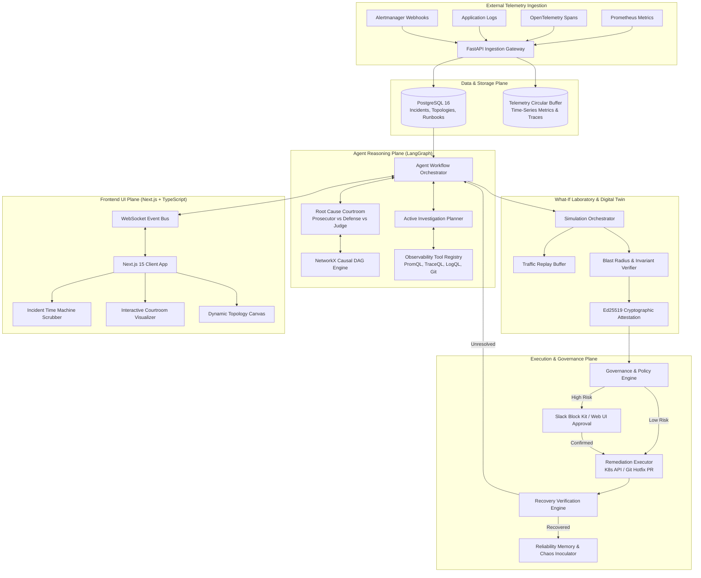
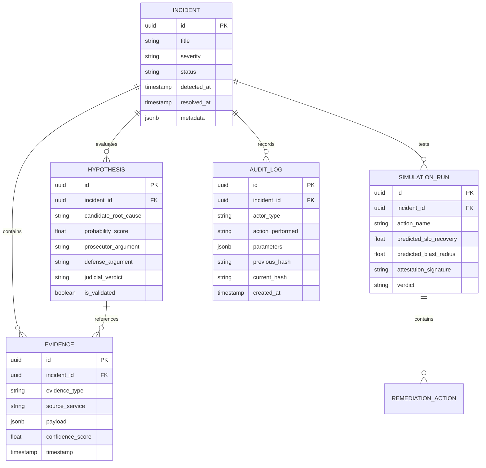

# 🏗️ INCIDENTX AI — Technical Architecture Specification

> **Project Name:** INCIDENTX AI  
> **Status:** Phase 0 Architectural Blueprint  
> **Authors:** Principal Software Architect, Senior Python Developer & AI Systems Engineer

---

## 1. Architectural Principles

INCIDENTX AI is built on four core architectural tenets:
1. **Asynchronous, Event-Driven Core**: Observability data and telemetry alerts arrive at high velocity; ingestion, investigation, and simulation are decoupled via asynchronous message buses and state graphs.
2. **Determinism Surrounding Non-Determinism**: While LLM agents provide hypothesis generation and semantic reasoning, all graph traversals, safety policy checks, cryptographic verifications, and tool invocations are deterministic.
3. **Pluggable & Provider-Agnostic AI**: The reasoning plane is decoupled from specific model providers (supporting Google Gemini, Anthropic Claude, OpenAI, and local Ollama instances) via standard LangGraph interfaces.
4. **Strict Isolation of Mutation Actions**: Diagnostic tools are read-only; remediation tools require formal approval tokens and are validated through an ephemeral simulation pipeline.

---

## 2. Technology Stack Selection & Rationale

```
┌─────────────────────────────────────────────────────────────────────────────┐
│                           TECHNOLOGY STACK MATRIX                           │
├────────────────────┬─────────────────────────────┬──────────────────────────┤
│ Layer              │ Technology                  │ Selection Rationale      │
├────────────────────┼─────────────────────────────┼──────────────────────────┤
│ **Frontend**       │ Next.js 15 (React 19)       │ Industry standard for    │
│                    │ TypeScript                  │ enterprise SPAs; SSR/SSG │
│                    │ Tailwind CSS                │ support; type safety for │
│                    │                             │ complex telemetry schemas│
├────────────────────┼─────────────────────────────┼──────────────────────────┤
│ **Backend**        │ Python 3.12                 │ Native ecosystem for     │
│                    │ FastAPI                     │ AI/ML, data science, and │
│                    │ Pydantic v2                 │ graph analysis; fast     │
│                    │ Uvicorn                     │ async I/O; strict schema │
│                    │                             │ validation with Pydantic │
├────────────────────┼─────────────────────────────┼──────────────────────────┤
│ **AI & Agents**    │ LangGraph                   │ Stateful multi-agent     │
│                    │ Configurable LLM Provider   │ graphs with cycles,      │
│                    │ (Gemini, Anthropic, OpenAI) │ branching, checkpointing │
│                    │                             │ and human-in-the-loop    │
├────────────────────┼─────────────────────────────┼──────────────────────────┤
│ **Database**       │ PostgreSQL 16               │ Robust transactional ACID│
│                    │ SQLAlchemy 2.0 (Async)      │ storage for incidents and│
│                    │ Alembic                     │ audit logs; schema migra-│
│                    │                             │ tions with Alembic       │
├────────────────────┼─────────────────────────────┼──────────────────────────┤
│ **Graph Engine**   │ NetworkX                    │ Mature, robust in-memory │
│                    │                             │ graph algorithms (DAGs,  │
│                    │                             │ PageRank, topological    │
│                    │                             │ sorts, path traversal)   │
├────────────────────┼─────────────────────────────┼──────────────────────────┤
│ **Observability**  │ OpenTelemetry               │ Vendor-neutral standards │
│                    │ Prometheus                  │ for distributed traces,  │
│                    │                             │ metrics time-series, and │
│                    │                             │ structured alerts        │
├────────────────────┼─────────────────────────────┼──────────────────────────┤
│ **Infrastructure** │ Docker Compose              │ Single-command local dev │
│                    │                             │ orchestration; modular   │
│                    │                             │ containerized boundaries │
├────────────────────┼─────────────────────────────┼──────────────────────────┤
│ **Testing**        │ Pytest + pytest-asyncio     │ Standard Python testing  │
│                    │ Playwright / Jest           │ framework; end-to-end and│
│                    │                             │ component UI test runner │
└────────────────────┴─────────────────────────────┴──────────────────────────┘
```

---

## 3. High-Level System Architecture



---

## 4. Detailed Monorepo Directory Layout

The codebase is organized as follows:

```
incidentx-ai/
├── backend/
│   ├── app/
│   │   ├── api/                           # REST & WebSocket route definitions
│   │   │   ├── v1/
│   │   │   │   ├── incidents.py           # Incident lifecycle endpoints
│   │   │   │   ├── telemetry.py           # Metrics, logs, traces query endpoints
│   │   │   │   ├── courtroom.py           # Adversarial debate streaming
│   │   │   │   ├── simulation.py          # What-If scenario triggers
│   │   │   │   └── webhooks.py            # Alertmanager/Datadog ingestion
│   │   │   └── websockets.py              # Real-time event streaming router
│   │   ├── core/                          # Cross-cutting foundational modules
│   │   │   ├── config.py                  # Pydantic Settings & environment parsing
│   │   │   ├── database.py                # Async SQLAlchemy engine & sessions
│   │   │   ├── logging.py                 # Structured JSON logging
│   │   │   └── security.py                # Token verification & execution signing
│   │   ├── models/                        # SQLAlchemy relational models
│   │   │   ├── incident.py                # Incident, severity, lifecycle state
│   │   │   ├── evidence.py                # Exhibits, metric anomalies, log traces
│   │   │   ├── hypothesis.py              # Root cause hypotheses & verdicts
│   │   │   ├── simulation.py              # Candidate actions, blast radius scores
│   │   │   └── audit.py                   # Hash-chained execution audit logs
│   │   ├── schemas/                       # Pydantic request/response schemas
│   │   │   ├── incident.py
│   │   │   ├── telemetry.py
│   │   │   ├── courtroom.py
│   │   │   └── simulation.py
│   │   └── services/                      # Domain logic services
│   │       ├── incident/                  # Incident state machine & management
│   │       ├── observability/             # Prometheus, OpenTelemetry & log connectors
│   │       ├── causal/                    # NetworkX graph analysis & causal DAGs
│   │       ├── agents/                    # LangGraph multi-agent orchestrator
│   │       ├── investigation/             # Active Investigation Planner & LATS
│   │       ├── simulation/                # What-If Laboratory & shadow replays
│   │       ├── remediation/               # Safe action execution & policy gates
│   │       ├── verification/              # Post-remediation SLO recovery verification
│   │       └── memory/                    # Reliability Memory & chaos regression generator
│   ├── alembic/                           # Database migration scripts
│   ├── requirements.txt                   # Production Python dependencies
│   ├── requirements-dev.txt               # Development & testing dependencies
│   └── main.py                            # FastAPI application entrypoint
├── frontend/
│   ├── src/
│   │   ├── app/                           # Next.js 15 App Router pages
│   │   │   ├── layout.tsx                 # Root layout & theme providers
│   │   │   ├── page.tsx                   # Main IncidentX command console
│   │   │   ├── incidents/[id]/page.tsx    # Incident detail & Time Machine page
│   │   │   └── courtroom/[id]/page.tsx    # Live Root Cause Courtroom debate
│   │   ├── components/                    # Modular UI components
│   │   │   ├── time-machine/              # Temporal scrubber & synchronized charts
│   │   │   ├── courtroom/                 # Prosecutor, Defense & Judicial bench cards
│   │   │   ├── topology/                  # Microservice dependency mesh canvas
│   │   │   ├── simulation/                # What-If Laboratory & blast radius meters
│   │   │   └── shared/                    # Navigation, audio toggles, status pills
│   │   ├── lib/                           # Utility libraries & API client
│   │   │   ├── api.ts                     # Fetch wrapper for backend REST API
│   │   │   ├── ws.ts                      # WebSocket client with auto-reconnect
│   │   │   └── audio.ts                   # Web Audio API procedural sound engine
│   │   └── types/                         # TypeScript interfaces & DTOs
│   │       ├── incident.ts
│   │       ├── telemetry.ts
│   │       └── courtroom.ts
│   ├── package.json
│   ├── tsconfig.json
│   └── tailwind.config.ts
├── infrastructure/
│   ├── docker/
│   │   ├── Dockerfile.backend
│   │   └── Dockerfile.frontend
│   ├── prometheus/                        # Prometheus testbed configuration
│   │   └── prometheus.yml
│   ├── opentelemetry/                     # OTel collector pipeline definition
│   │   └── otel-collector-config.yaml
│   └── docker-compose.yml                 # Local orchestration stack
├── docs/                                  # Architectural specifications
├── scripts/                               # Maintenance & seeding scripts
├── tests/
│   ├── backend/                           # Pytest unit, integration & agent tests
│   └── frontend/                          # Playwright & Jest UI tests
├── .env.example
├── .gitignore
└── README.md
```

---

## 5. Core Domain Services & Architectural Specifications

### 5.1 Observability Service (`services/observability/`)
- Ingests raw telemetry from Prometheus (PromQL), OpenTelemetry collector (traces), and log aggregators.
- Normalizes data into typed Pydantic models: `MetricTimeSeries`, `TraceWaterfall`, `LogEvent`.
- Implements a circular memory buffer storing the last 60 minutes of high-resolution telemetry for temporal reconstruction.

### 5.2 Causal Reasoning Service (`services/causal/`)
- Constructs microservice dependency directed acyclic graphs (DAGs) using **NetworkX**.
- Nodes represent microservices, databases, queues, and cloud resources.
- Edges represent gRPC, HTTP, Kafka, or TCP dependency paths.
- Computes topological sorts, reachable subgraphs from alert entry points, and path centrality metrics.

### 5.3 Agent Orchestration Service (`services/agents/`)
- Built using **LangGraph** to manage the lifecycle of an incident.
- Manages stateful transitions between:
  `Triage ➔ Active Investigation ➔ Courtroom Debate ➔ What-If Simulation ➔ Remediation Approval ➔ Verification ➔ Inoculation`.
- Incorporates checkpointing to allow state rollback, step-by-step inspection, and human intervention.

### 5.4 Active Investigation Planner (`services/investigation/`)
- Implements **Language Agent Tree Search (LATS)**.
- Given an alert, generates competing diagnostic hypotheses ($H_1, H_2, \dots, H_n$).
- Evaluates the Shannon Entropy of the hypothesis probability distribution.
- Queries the tool that maximizes expected information gain at minimal infrastructure risk.

### 5.5 Simulation Service (`services/simulation/`)
- Coordinates the **What-If Laboratory**.
- Simulates candidate actions against an in-memory replica state or ephemeral sandbox container.
- Measures predicted SLO recovery and calculates blast radius ($< 0.01\%$).
- Signs an Ed25519 attestation token certifying simulation safety.

### 5.6 Remediation & Verification Service (`services/remediation/`, `services/verification/`)
- Enforces risk tier permissions (Tier 0 Read-Only, Tier 1 Low Risk Auto, Tier 2 Medium Risk HITL, Tier 3 Destructive).
- Dispatches verified commands to target APIs (e.g. Kubernetes API, Git commit revert).
- Re-evaluates telemetry post-execution to confirm that error rates and latencies have normalized.

### 5.7 Reliability Memory Service (`services/memory/`)
- Persists post-mortems and causal DAGs.
- Synthesizes automated chaos engineering test suites (e.g. Chaos Mesh CRD YAML or k6 test scripts) replicating the exact failure mechanism to prevent recurrence.

---

## 6. Database Schema Design (SQLAlchemy Core Models)



---

## 7. Security, Isolation, and Guardrail Architecture

1. **Deterministic Execution Sandbox**:
   - The AI agent runtime has **no direct shell or terminal access**.
   - All tool invocations map to strictly typed Python functions with Pydantic parameter validation.
2. **Cryptographic Attestation Chain**:
   - Remediation actions must carry a valid Ed25519 signature generated by the What-If simulation service; unsigned payloads are rejected by the execution engine.
3. **Immutable Audit Ledger**:
   - Every agent thought, evidence exhibit, debate turn, and human approval is cryptographically chained (`current_hash = SHA256(previous_hash + payload)`) to prevent tampering.
