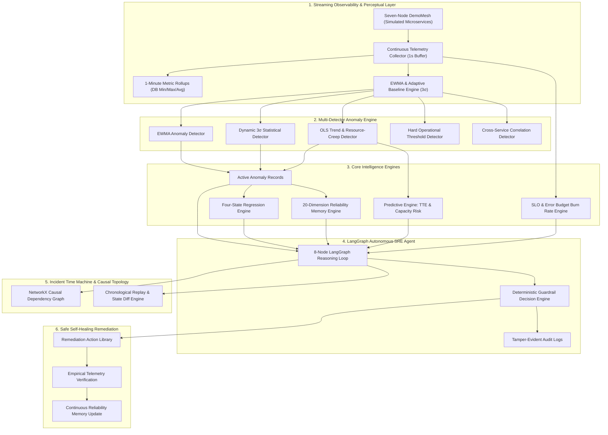

# IncidentX AI — Phase 5 Architecture Specification
## Continuous Reliability Intelligence & Autonomous Self-Healing Platform

### 1. Executive Architecture Overview

IncidentX AI transforms traditional, reactive incident response into an autonomous, continuously learning **Site Reliability Engineering (SRE) Intelligence Platform**. The perception-to-action control loop operates through eight integrated layers:

---

### 2. Mathematical Formulations & Specifications

#### 2.1 Exponentially Weighted Moving Average (EWMA)
For streaming signal $x_t$ at time step $t$:
$$S_t = \alpha x_t + (1 - \alpha) S_{t-1}$$
Adaptive baseline variance:
$$\sigma_t^2 = \beta (x_t - S_t)^2 + (1 - \beta) \sigma_{t-1}^2$$
Anomaly score (standardized departure):
$$Z_t = \frac{|x_t - S_t|}{\sigma_t}$$
Departure flagged when $Z_t \ge 3.0$ (3σ confidence limit).

#### 2.2 Ordinary Least Squares (OLS) Trend Regression
For time-series points $(t_i, y_i)_{i=1}^N$:
$$\bar{t} = \frac{1}{N}\sum t_i, \quad \bar{y} = \frac{1}{N}\sum y_i$$
$$m = \frac{\sum_{i=1}^N (t_i - \bar{t})(y_i - \bar{y})}{\sum_{i=1}^N (t_i - \bar{t})^2}, \quad b = \bar{y} - m\bar{t}$$
Coefficient of determination:
$$R^2 = 1 - \frac{\sum (y_i - \hat{y}_i)^2}{\sum (y_i - \bar{y})^2}$$

#### 2.3 Time-to-Exhaustion (TTE)
For capacity metric with operational breach ceiling $C_{\text{thresh}}$ and positive growth slope $m > 0$:
$$\text{TTE} = \frac{C_{\text{thresh}} - y_{\text{current}}}{m}$$
- If $y_{\text{current}} \ge C_{\text{thresh}}$, $\text{TTE} = 0.0$ (breached).
- If $m \le 0$, $\text{TTE} = \infty$ (stable or recovering).

#### 2.4 Multi-Window Error Budget Burn Rate
Given target Service Level Objective $T_{\text{SLO}}$ (e.g. 99.9%):
$$\text{Allowed Error Rate} = 100.0 - T_{\text{SLO}}$$
$$\text{Actual Bad Rate} = \max(0.0, 100.0 - \text{SLI}_{\text{current}})$$
$$\text{Burn Rate} = \frac{\text{Actual Bad Rate}}{\text{Allowed Error Rate}}$$
Alert Tiers (Google SRE Standard):
- **Fast Burn Alert**: Burn Rate $\ge 14.4\times$ (consumes 2% of 30-day budget in 1 hour; exhaustion in $< 50$ hours).
- **High Burn Alert**: Burn Rate $\ge 6.0\times$ (consumes 5% of 30-day budget in 6 hours).
- **Slow Burn Alert**: Burn Rate $> 1.0\times$ (budget will be exhausted before window concludes).

#### 2.5 Multi-Feature Fingerprint Similarity
$$\text{Sim}(F_A, F_B) = w_{\text{svc}} J(S_A, S_B) + w_{\text{metric}} \cos(V_A, V_B) + w_{\text{rc}} J(R_A, R_B) + w_{\text{err}} \text{Dice}(E_A, E_B)$$
Where:
- $J(A, B) = \frac{|A \cap B|}{|A \cup B|}$ (Jaccard similarity on sets)
- $\cos(V_A, V_B) = \frac{V_A \cdot V_B}{\|V_A\|_2 \|V_B\|_2}$ (Cosine similarity on anomaly departures)
- Weights: $w_{\text{svc}} = 0.25, w_{\text{metric}} = 0.35, w_{\text{rc}} = 0.25, w_{\text{err}} = 0.15$.
