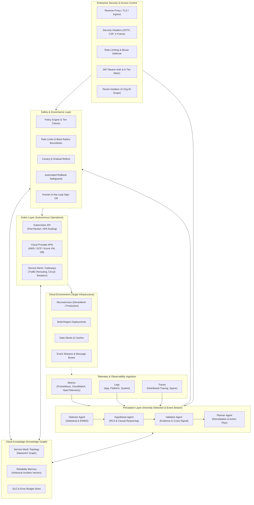

# IncidentX AI — Stage 6.0: Enterprise Production Readiness & Gap Analysis
**Document Version:** 1.0.0  
**Date:** November 11, 2026  
**Auditor:** Principal Enterprise Software Architect, Cybersecurity Architect & Principal SRE  
**Scope:** Full-Stack Architecture, Enterprise Security, IAM/RBAC, Multi-Tenancy, Resiliency, Scaling, DevSecOps  

---

## 1. Executive Summary

IncidentX AI has completed Phases 0 through 5, establishing a functional, test-verified platform with:
- Simulated seven-node microservice mesh (**DemoMesh**) with 6 canonical telemetry signals.
- Automated incident detection, root-cause investigation, and evidence analysis.
- Safe autonomous remediation engine with human approval guardrails, risk tiers, and rollback controls.
- Continuous observability with 1-second telemetry buffering and 1-minute historical rollups.
- Advanced anomaly detection (adaptive $3\sigma$ baselines, EWMA trend tracking, OLS slope resource-creep detection).
- Regression Detection Lab with four-state comparative analytics and multi-feature fingerprint matching.
- Persistent Reliability Memory Engine indexing 20-dimension historical incident records and empirical remediation learning.
- Predictive Reliability Intelligence with Time-to-Exhaustion ($TTE$) forecasting and cluster capacity risk matrices.
- Service Level Objective (SLO) error budget tracking with Google SRE multi-window burn rate alerts.
- Incident Time Machine with NetworkX causal dependency topology and point-in-time historical replay.
- LangGraph 8-node autonomous SRE intelligence agent.
- Next.js 15.5 production-compiled Reliability Command Center UI (`/reliability`).
- Comprehensive test suite of **195 passing automated tests (100% pass rate)**.

### The Production Readiness Challenge
While Phase 5 demonstrated deep reliability engineering and AI orchestration capabilities, the platform currently operates as an **unauthenticated, single-tenant, file-based prototype**. To achieve enterprise production readiness for Fortune 500 SRE and platform engineering teams, IncidentX AI must undergo an enterprise transformation across:
1. **Enterprise Application Security:** Hardening headers, rate limiting, request validation, secret hygiene, and input sanitization.
2. **Identity & Access Management (IAM / RBAC):** Argon2id hashing, rotating JWT/refresh tokens, and 6 discrete enterprise roles.
3. **Multi-Tenant Organization Isolation:** Scoped multi-organization data tenancy at the database, API, and AI agent levels.
4. **Resilience, Scalability & DevSecOps:** Migration to PostgreSQL pooling, background worker decoupling, CI/CD pipelines, and Infrastructure as Code.

---

## 2. Comprehensive Architectural Audit by Domain

### 2.1 Backend Architecture
- **Current Implementation:** Python 3.12+, FastAPI, Uvicorn, Pydantic v2 Settings.
  - Endpoints structured under `/api/v1/` across 10 routers (`health`, `incidents`, `services`, `investigation`, `audit`, `observability`, `telemetry`, `simulation`, `remediation`, `reliability`).
  - Asynchronous handlers using `AsyncSession`.
- **Identified Gaps & Vulnerabilities:**
  - **Zero Authentication Enforcement:** All endpoints are open and callable without credentials or session cookies.
  - **In-Memory Singleton Coupling:** `demo_mesh`, `observability_collector`, and `LangGraphReliabilityAgent._last_run_cache` store state in python process memory. Running multiple Uvicorn worker processes or container replicas causes split-brain state, duplicate background tasks, and uncoordinated ticks.
  - **Missing Circuit Breakers:** External AI calls (Gemini, OpenAI, Anthropic) lack automated circuit breaker protection against third-party latency degradations.

### 2.2 Frontend Architecture
- **Current Implementation:** Next.js 15.5.29 (App Router), TypeScript, Tailwind CSS, Lucide icons.
  - Routes: `/`, `/incidents`, `/incidents/[id]`, `/services`, `/telemetry`, `/regression`, `/reliability`, `/remediation`, `/simulation`, `/settings`.
  - Global navigation sidebar and real-time polling clients in `services/api.ts`.
- **Identified Gaps & Vulnerabilities:**
  - **Missing Auth & Session Context:** No login screen, registration view, password reset flow, or user profile menu.
  - **Lack of Authorization Gating:** UI controls (such as "Execute Remediation", "Trigger Simulation", "Rollback Action") are visible and clickable by any unauthenticated visitor.
  - **Missing Organization Context:** No organization/workspace switcher.
  - **Standalone Build Configuration Bug:** `infrastructure/docker/Dockerfile.frontend` attempts to copy `.next/standalone`, but `frontend/next.config.mjs` lacks `output: 'standalone'`, breaking Docker container builds.

### 2.3 Database Design & Relational Models
- **Current Implementation:** SQLAlchemy 2.0 with async engine.
  - Currently defaulting to SQLite (`sqlite+aiosqlite:///./incidentx.db`) with 19 active tables.
  - `Base.metadata.create_all` and `migration_phase5.py` handle schema creation on boot.
- **Identified Gaps & Vulnerabilities:**
  - **No Identity Models:** Missing `users`, `organizations`, `organization_members`, `roles`, `permissions`, `refresh_tokens`.
  - **Missing Tenant Scoping:** None of the 19 existing tables (`incidents`, `services`, `telemetry_events`, `slo_definitions`, `remediation_actions`, `audit_logs`, `incident_memories`) have an `organization_id` foreign key.
  - **SQLite Concurrency Bottleneck:** SQLite uses database-level write locks. Under concurrent multi-user write traffic or high-frequency telemetry ingestion, `sqlite3.OperationalError: database is locked` will occur.
  - **Outdated Alembic Revision Chain:** Only 1 initial migration exists in `alembic/versions/`. Migrations for Phases 4 and 5 were executed imperatively, preventing reproducible automated database rollbacks.

### 2.4 API Security & Network Boundary
- **Current Implementation:** `CORSMiddleware` using `settings.ALLOWED_ORIGINS`, `RequestContextMiddleware` for UUID injection.
- **Identified Gaps & Vulnerabilities:**
  - **No Rate Limiting:** High-frequency mutation endpoints (e.g. `/simulation/scenarios/clear`, `/remediation/execute`, `/reliability/agent/assess`) have no throttling.
  - **Missing Enterprise Security Headers:** Lacks HTTP security headers:
    - `Strict-Transport-Security (HSTS)`
    - `Content-Security-Policy (CSP)`
    - `X-Frame-Options: DENY`
    - `X-Content-Type-Options: nosniff`
    - `Referrer-Policy: strict-origin-when-cross-origin`
  - **Unbounded Request Payloads:** No request body size limits; vulnerable to memory exhaustion attacks.
  - **Missing Anti-CSRF Protection:** State-changing requests lack Double-Submit Cookie or SameSite CSRF defense.

### 2.5 AI Agent Permissions & Security
- **Current Implementation:** LangGraph 8-node loop in `reliability_agent.py`, deterministic fallback trees in `decision_policy`, prompt sanitizer in `sanitizer.py`.
- **Identified Gaps & Vulnerabilities:**
  - **Prompt Injection Defense:** External error logs from user infrastructure are fed into root-cause extraction. Malicious payloads could attempt jailbreaks to influence remediation recommendations.
  - **Tool Allowlist Enforcement:** Agent tool execution must be strictly gated by tenant permissions and cannot execute arbitrary shell commands.
  - **Audit Immutability:** Agent decisions are written to `audit_logs`, but the audit table lacks cryptographic checksumming or tamper-evident verification.

### 2.6 Background Telemetry & Jobs
- **Current Implementation:** `observability_collector` (1-second tick) and `observability_engine` (5-second anomaly scan) started in FastAPI lifespan.
- **Identified Gaps & Vulnerabilities:**
  - If backend is scaled horizontally to $N$ instances, $N$ collectors will simultaneously generate simulated ticks and insert redundant rollups.
  - Needs a distributed leader election or dedicated worker process boundary.

### 2.7 Docker, CI/CD & DevSecOps
- **Current Implementation:** `docker-compose.yml` with `postgres`, `backend`, `frontend`.
- **Identified Gaps & Vulnerabilities:**
  - **Zero CI/CD Automation:** No `.github/workflows/` directory. No automated pull-request validation, linting, security scanning, or test execution.
  - **No Vulnerability Scanning:** No Trivy, Bandit, or pip-audit scanning in pipeline.
  - **Hardcoded Insecure Defaults:** `.env.example` and `docker-compose.yml` contain default passwords (`incidentx_dev_password`, `dev-insecure-secret-key...`) that could accidentally be used in production.

---

## 3. Threat Model & Security Risk Matrix

| Threat Category | Attack Vector | Potential Impact | Severity | Mitigation in Phase 6 |
|---|---|---|---|---|
| **Unauthorized Access** | Direct unauthenticated API invocation | Arbitrary incident mutation, trigger remediation | **CRITICAL** | JWT Bearer Authentication & RBAC dependency on all routes |
| **Cross-Tenant Leakage** | Tenant A queries Tenant B's incident memory or traces | Regulatory breach, intellectual property theft | **CRITICAL** | Organization-scoped database filters & tenant-aware AI memory |
| **Prompt Injection** | Adversarial payload injected into application error logs | Agent tricked into recommending destructive action | **HIGH** | Strict structural schema validation, separation of untrusted content, deterministic safety guardrails |
| **API Abuse / DoS** | High-volume burst requests to `/simulation` or `/agent` | Resource exhaustion, crash backend event loop | **HIGH** | Redis/In-memory sliding window rate limiting (SlowAPI) |
| **Credential Theft** | Plaintext password storage or weak MD5/SHA1 hashing | Mass account compromise | **CRITICAL** | Argon2id / bcrypt password hashing with unique salt |
| **Privilege Escalation** | Viewer modifying role or approving remediation | Unauthorized operational changes on production | **HIGH** | Strict RBAC role hierarchy enforced at endpoint level |
| **Audit Tampering** | Malicious actor deleting or updating audit logs | Loss of incident forensics and regulatory non-compliance | **HIGH** | Append-only audit table with update/delete prohibitions |
| **Supply Chain Vulnerability**| Outdated or compromised Python/Node dependencies | Remote code execution or data exfiltration | **MEDIUM**| Automated `pip-audit`, `npm audit`, and Trivy container scanning |

---

## 4. Production Gap Summary Matrix

| Domain | Current Prototype State | Enterprise Production Target |
|---|---|---|
| **Authentication** | None (public endpoints) | JWT Bearer + Secure Refresh Tokens + Argon2id |
| **Authorization** | None (all operations allowed) | 6 Enterprise Roles (`SUPER_ADMIN` to `READ_ONLY`) |
| **Multi-Tenancy** | Single-tenant (no organization scoping) | Organization-scoped tenancy with strict DB isolation |
| **API Security** | Open CORS, no rate limits, no security headers | Rate limiting, HSTS, CSP, X-Frame-Options, CSRF |
| **Database** | SQLite development file | PostgreSQL 16 with connection pooling & full Alembic chain |
| **Background Processing**| Embedded in web server event loop | Decoupled background worker with leader election |
| **Secret Management** | Insecure fallback strings in code | Strict environment validation, secret redaction in logs |
| **CI/CD** | Manual execution | GitHub Actions CI/CD with Bandit, Trivy, and Pytest |
| **Infrastructure as Code**| Docker Compose only | Multi-stage Docker, Terraform Cloud blueprints |
| **UI Governance** | Developer console | Organization management, user roles, audit log viewer |

---

## 5. Recommended Enterprise Architecture

The enterprise target architecture directly operationalizes the Autonomous SRE Intelligence pattern:

---

## 6. Phase 6 Implementation Roadmap (Sequential Execution)

```mermaid
flowchart LR
    S60["6.0 Audit & Plan"] --> S61["6.1 Enterprise Security"]
    S61 --> S62["6.2 Auth & RBAC"]
    S62 --> S63["6.3 Multi-Tenancy"]
    S63 --> S64["6.4 Integrations"]
    S64 --> S65["6.5 Event Architecture"]
    S65 --> S66["6.6 Fault Tolerance"]
    S66 --> S67["6.7 Scaling & Perf"]
    S67 --> S68["6.8 DevSecOps & CI"]
    S68 --> S69["6.9 Cloud IaC"]
    S69 --> S610["6.10 Governance"]
    S610 --> S611["6.11 Final Release"]
```

### Next Immediate Step: Stage 6.1 — Enterprise Security Architecture Plan

Before implementing identity and multi-tenancy, Stage 6.1 establishes the foundational security substrate across the entire application:

1. **Security Settings & Environment Hygiene:**
   - Enforce minimum 32-character `SECRET_KEY` in production; reject default insecure keys on startup when `APP_ENV=production`.
   - Implement `backend/app/core/security.py` with cryptographic utilities.
2. **Enterprise HTTP Security Headers Middleware:**
   - Inject HSTS (`max-age=31536000; includeSubDomains`), CSP, `X-Frame-Options: DENY`, `X-Content-Type-Options: nosniff`.
3. **API Rate Limiting:**
   - Implement sliding-window rate limiting on all public and mutation endpoints (e.g. 60 requests/minute for general APIs, 10 requests/minute for remediation execution).
4. **Input Sanitization & Redaction:**
   - PII and credential redaction filter in structured logging (masks `password`, `token`, `api_key`, `secret`).
   - HTML/script sanitization on user-supplied strings before database persistence.
5. **AI Agent Tool Guardrails:**
   - Strict input validation schemas on all internal tools.
   - Prohibit raw shell execution.
   - Enforce that AI agents can never bypass human approval policies for high-risk interventions.
6. **Automated Security Verification:**
   - Suite of automated security tests in `tests/backend/test_stage_6_1_security.py` verifying headers, rate limits, injection resistance, and secret protection.
